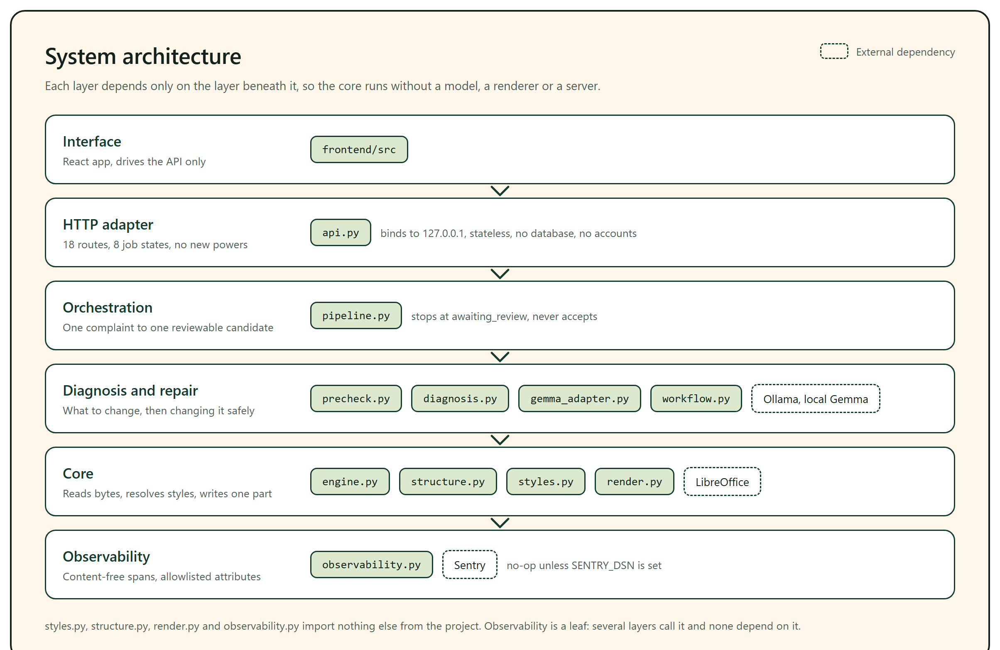
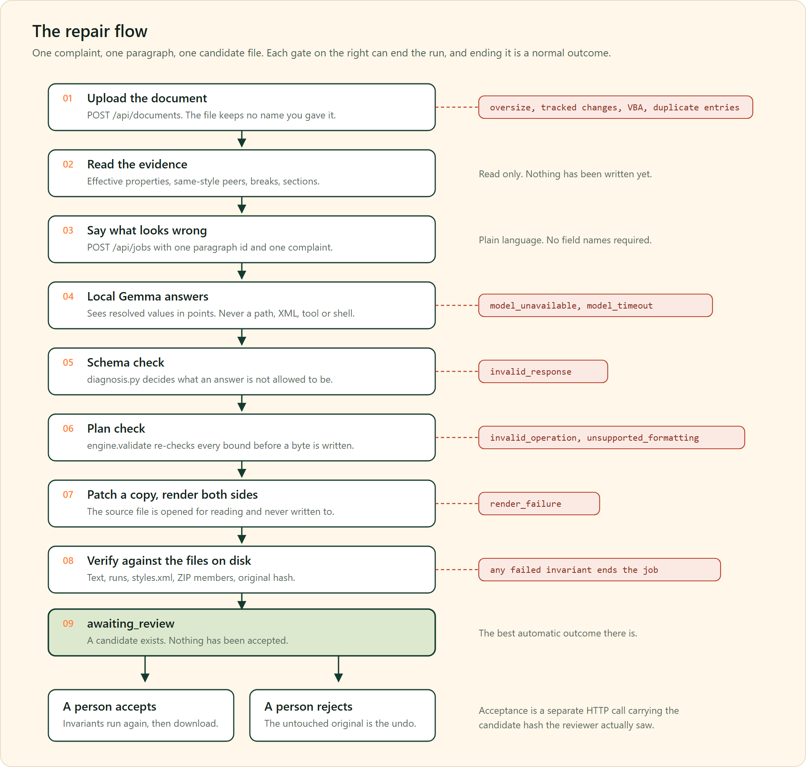
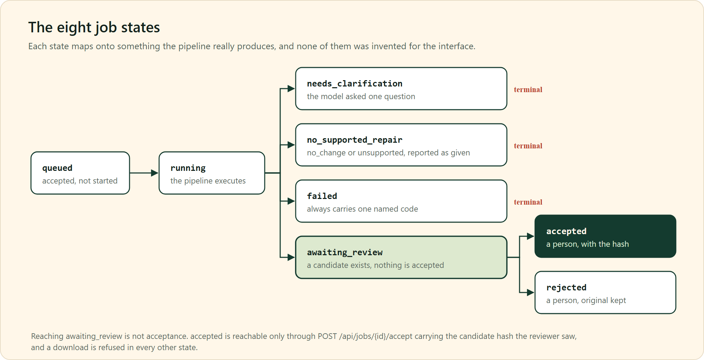
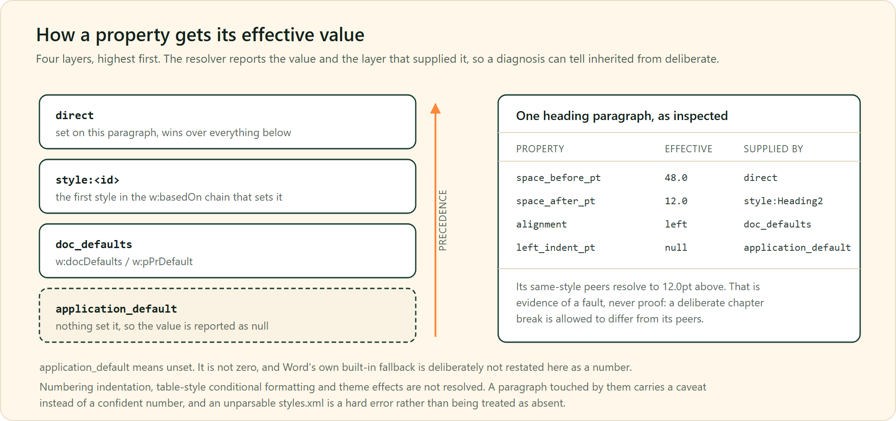
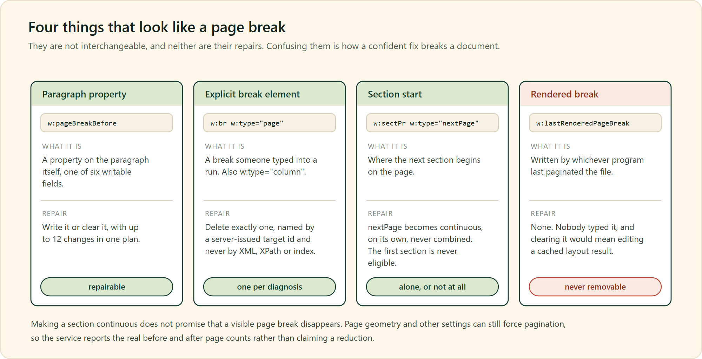

<p align="center">
  
</p>

<h1 align="center">What the Doc?!</h1>

<p align="center"><b>Point at the formatting problem. Get a targeted, reviewable repair.</b></p>

You open a Word document and something is off. A heading floats too far down the page.
One paragraph is centred when the rest are justified. A page break strands two lines on
a page of their own. You know what is wrong but not what it is called, and the fix is
buried three dialogs deep.

This project takes the complaint in plain language, finds the evidence in the file,
proposes exactly one bounded change, renders the before and after, checks that nothing
else moved, and then stops and waits for you. It never accepts its own repair.

A local Gemma does the diagnosis. The document never leaves the machine, there is no
API key, and the model is only ever allowed to fill in a plan the engine already knew
how to validate.

---

## Contents

| | |
| --- | --- |
| [What exists today](#what-exists-today) | the honest status |
| [System architecture](#system-architecture) | how the modules stack up |
| [The repair flow](#the-repair-flow) | upload to download, gate by gate |
| [Job states](#job-states) | the eight states and what they mean |
| [How evidence is resolved](#how-evidence-is-resolved) | effective properties, not guesses |
| [Three repairs, and one non-repair](#three-repairs-and-one-non-repair) | the page-break trap |
| [Run it locally](#run-it-locally) | five minutes, no model needed |
| [The live Gemma layer](#the-live-gemma-layer) | setup, prompt, failures, numbers |
| [The local HTTP API](#the-local-http-api) | what the frontend drives |
| [Repository layout](#repository-layout) | every file, one line each |
| [Limits](#limits) | and what this is deliberately not |

Deeper reading lives in its own files. [`CAPABILITIES.md`](CAPABILITIES.md) is the one
page that separates what is repairable from what is merely detectable, and it wins over
any claim made anywhere else, including here. [`API.md`](API.md) is the complete HTTP
contract. [`TEST_RESULTS.md`](TEST_RESULTS.md) records what each run actually
established. [`START_HERE.md`](START_HERE.md) is the five-minute version of this page.

---

## What exists today

Five milestones are in place: a constrained DOCX inspection and patching core, effective
paragraph-style resolution with a before and after rendering workflow, a live local
Gemma diagnosis layer, a local HTTP adapter over that pipeline, and two structural
operations (removing one explicit break, and turning one next-page section start into a
continuous one).

What that adds up to in practice:

| | |
| --- | --- |
| **Six paragraph properties** can be written | spacing before and after, left indent, alignment, `page_break_before`, `keep_with_next` |
| **One explicit break element** can be deleted | a `w:br` of type `page` or `column`, one per diagnosis, named only by a server-issued target id |
| **One section start** can be converted | `nextPage` to `continuous`, on its own, and only when the section qualifies |
| **Everything else about a section** is read only | no section is created, merged, split or deleted, and no column layout, page size, margin, orientation, numbering, header or footer is touched |

Three caveats, stated once here and enforced everywhere else in the code. No real user
document has ever been repaired; every sample is synthetic and generated by this
repository. There is no authentication and no MongoDB connection, and no Tinker training
has been run. Making a section continuous does not promise that a visible page break
disappears, because page geometry can still force pagination, so the service reports the
real before and after page counts instead of claiming a reduction.

Rendering is done by local LibreOffice. Microsoft Word was used as a cross-check on one
fixture: Word agreed with the resolver on 15 of 15 comparable fields, 11 of them
inherited from a style, and reported the same page counts as LibreOffice. That is one
synthetic document on one Word build, not a general claim that the two applications
paginate alike, so rendered pages stay an approximation.

---

## System architecture



The direction of dependency is the whole design. The HTTP adapter calls the pipeline,
the pipeline calls diagnosis and workflow, and those call the engine. Nothing lower
reaches back up, which is why `engine.py inspect` keeps working with no model installed,
no renderer present and no server running.

`api.py` is an adapter, not a second engine. Every bound, validator and preservation
invariant it applies is the one `pipeline.run`, `engine.validate` and
`workflow.check_invariants` already apply from the command line. If the HTTP layer
disappeared tomorrow, nothing about what is safe to change would move.

---

## The repair flow



Two things in that picture matter more than the rest.

**The gates on the right are not errors.** A model that cannot reach a supported repair,
a response that breaks the schema, a plan that would write a value the layout then
ignores: each of those ends the run with a named code, and that is a correct outcome.
Abstention is a result, not a failure to produce one.

**Nothing is ever written to your file.** The source is opened for reading. A candidate
is patched from a copy and named from its parent's hash plus the proposal hash, so
re-running the same proposal reuses that candidate instead of patching an already
patched copy. There is no overwrite path, and undo is going back to the file you started
with.

---

## Job states



`awaiting_review` is the best outcome the machine can reach on its own. Getting there
means a candidate file exists, both sides rendered, and the preservation invariants
re-checked against the files on disk. It does not mean the repair is right, and no
changed-pixel ratio is treated as approval.

`accepted` is reachable only through `POST /api/jobs/{id}/accept` carrying the candidate
hash the reviewer actually saw. The invariants run again at acceptance and once more
before any bytes are served for download, and download is refused in every other state.

---

## How evidence is resolved



`python engine.py inspect file.docx` reports, for each top-level body paragraph, both
the direct formatting as written and the effective value of every supported property,
labelled with the layer that supplied it.

```bash
python engine.py inspect your-document.docx
python engine.py peers   your-document.docx 6
```

`peers` compares one paragraph against the others sharing its style, so a diagnosis can
see that a heading resolves to 48pt where its peers inherit 12pt. That is evidence of a
fault and never proof of one. A deliberate chapter break or a one-off centred line is
allowed to differ, which is exactly why a person still has to look.

Where resolution is incomplete, it says so. Numbering indentation, table-style
conditional formatting and theme effects are not resolved, and a paragraph affected by
them carries a caveat rather than a confident number. An unparsable `word/styles.xml` is
a hard error, not an absence, because treating it as absent would quietly misreport
style-supplied values as application defaults.

---

## Three repairs, and one non-repair



This is the distinction the whole project is built around. Four different things in the
file produce the same visible symptom, and a tool that treats them as one thing will
confidently make the document worse.

The explicit-break removal has the tightest rules in the codebase. A break is named only
by a server-issued target id bound to the source revision and the expected break type,
never by XML, an XPath or an index. At most one removal is proposed per diagnosis. Only
that one element is deleted, with the run, its properties, the text on either side and
every other break left exactly as they were. A successful render of both the original
and the candidate is required before the result can be reviewed, accepted or downloaded,
and that requirement lives in the server rather than in one interface.

Breaks inside a table cell, text box, hyperlink or other wrapper are reported together
with the element that disqualifies them, and refused. Line breaks are never removable.
The first section of a document is never eligible for conversion, because its start type
describes a relationship to a previous section that does not exist.

---

## Run it locally

Python 3.10 or later. No model, renderer or server is needed for this part.

```bash
python -m venv .venv
.venv\Scripts\Activate.ps1          # Windows PowerShell
# source .venv/bin/activate         # macOS or Linux

pip install -r requirements.txt
python -m unittest -v
python engine.py inspect your-document.docx
```

On the recorded machine, with the full manifest installed and both LibreOffice and Word
available, `python -m unittest` runs **259 tests, 0 skipped, 0 failed**, and `npm test`
in `frontend/` runs **24 tests**. Neither suite contacts a model, a network service or
Sentry. The live measurements are separate commands, recorded separately in
`TEST_RESULTS.md`.

### Rendering

Rendering needs LibreOffice. It is found automatically in the usual install locations,
on `PATH`, and at `.tools/lo/program/soffice.exe` beside the project. Otherwise set
`SOFFICE_PATH` to the `soffice` binary. Without it, every rendering step reports itself
as skipped rather than passed, and the suite reports 5 skips instead of silently
passing.

On a machine where you cannot install per-machine software, the payload can be unpacked
beside the project instead, which needs no elevation and is what the recorded test run
used:

```bash
msiexec /a LibreOffice_<version>_Win_x86-64.msi /qn TARGETDIR=<repo>\.tools\lo
```

### A walkthrough on a known-faulty sample

`fixtures.py` builds a real, Word-openable four-page report carrying three labelled
faults: a 48pt space above a heading, a page break that strands the closing section on a
page of its own, and one centred body paragraph among justified ones. Each fault records
the repair a correct diagnosis should reach, so a run can be graded against a known
answer rather than an impression.

```bash
python demo.py work/demo                # add --no-render to skip LibreOffice
python demo.py work/demo --word         # also cross-check against Microsoft Word
```

Nine more prepared documents, with what to try on each, are in
[`TEST_IT_YOURSELF.md`](TEST_IT_YOURSELF.md) and [`test-documents/`](test-documents/).

### Applying a repair by hand

Make a plan using the exact `source_sha256` and `paragraph_id` from inspection:

```json
{
  "source_sha256": "COPY_THE_REAL_HASH_FROM_INSPECTION",
  "operations": [
    {"paragraph_id": 0, "field": "space_before_pt", "value": 12}
  ]
}
```

```bash
python engine.py apply your-document.docx plan.json repaired.docx   # patch only
python workflow.py     your-document.docx plan.json work/run        # full before and after
```

The workflow ends at `awaiting_review`. Raw length fields are in twips; effective values
are in points. A repair is refused when an alternative measurement anywhere in the
resolved chain would defeat it (`beforeAutospacing`, `afterAutospacing`, `beforeLines`,
`afterLines`, or character-unit indentation), because writing a value the layout then
ignores would look like a successful repair and change nothing.

### What the workflow guarantees

Checked against the files on disk after every run, independently of the patcher:

- the original file's sha256 is unchanged
- every `w:t` character survives, in order
- run count and run properties (bold, italic, fonts) are identical
- no body paragraph is added or removed
- `word/styles.xml` is unmodified, so a repair overrides formatting on the paragraph
  rather than editing styles shared with the rest of the document
- the ZIP member list matches, and only `word/document.xml` differs
- only the targeted paragraphs changed

Page comparison reports per-page changed-pixel ratios and any page-count change as
review signals. A correct repair legitimately reflows later text, so a large difference
is something to look at, not an automatic failure.

### Verifying against Microsoft Word

Word is the authority on what a paragraph's formatting resolves to, and it is what the
user actually opens. On Windows with Word installed, `word_check.py` opens a document
read-only and compares Word's own effective formatting against this project's resolver:

```bash
python word_check.py work/demo/sample-faulty.docx 1 10 19
```

Word is opened with macros force-disabled and alerts off, always quit without saving,
and the script refuses to run if Word is already open, so it cannot close a document you
have in front of you. A field is compared only where both sides state a value: where
this project reports `application_default`, Word still reports its own built-in number,
and that pair is recorded as not comparable rather than counted as agreement. The check
is optional and Windows-only, and an unavailable result means not verified, never
verified.

---

## The live Gemma layer

One command takes a document, a paragraph id and a complaint, and produces a diagnosis,
a validated proposal, rendered previews and a review status:

```bash
python pipeline.py your-document.docx 1 "Too much space above this heading." work/run
```

Add `--no-render` to skip LibreOffice, `--json` for the full report, `--model` to
override the model for one run, and `--timeout` to bound the wait. The command exits
non-zero only when the run failed. An abstention is a successful run that proposes
nothing. Every run writes `work/run/pipeline.json`.

### Setup

Gemma runs locally through [Ollama](https://ollama.com). No account, API key or paid
service is involved.

```powershell
winget install Ollama.Ollama        # or the installer from ollama.com
ollama pull gemma4:e2b              # the tag the recorded results used
$env:GEMMA_MODEL = "gemma4:e2b"

python fixtures.py work\run\sample-faulty.docx
python pipeline.py work\run\sample-faulty.docx 1 "Too much space above this heading." work\run
```

| variable | purpose |
| --- | --- |
| `GEMMA_MODEL` | the installed tag to use |
| `GEMMA_URL` | the endpoint, default `http://localhost:11434/api/chat` |
| `WTD_ALLOW_NON_GEMMA` | run a deliberate non-Gemma baseline, recorded as such |
| `SOFFICE_PATH` | the LibreOffice binary, if it is not found automatically |
| `SENTRY_DSN` | enables tracing; without it the SDK is never touched |

Gemma is required, not preferred. A tag from another family is refused with
`model_unavailable` rather than silently substituted. To see what the runtime actually
has:

```bash
python -c "import gemma_adapter, json; print(json.dumps(gemma_adapter.runtime_status(), indent=2))"
```

The recorded runs used **`gemma4:e2b`** (4.6B parameters, Q4_K_M, llama.cpp runner)
served by Ollama 0.40.6. `gemma4:e4b` is also installed on the recorded machine but was
not used for the headline numbers. The tag that actually ran is recorded in every
report, so a result can never be attributed to a model that did not produce it.
Inference is CPU-only on the recorded machine and can take several minutes per call. The
default timeout is 600s. No GPU is required and none was used.

### What the model sees, and what it may answer

It receives the complaint, the selected paragraph id, the document hash, and each nearby
paragraph's effective properties in points with the layer that supplied each one, plus
the same-style peer distribution and any resolution caveats. It never receives a file
path, raw XML, a tool or a shell. No hidden chain of thought is requested, because an
unverifiable reasoning trace is not what the validator checks.

It must answer with exactly this structure, which wraps the plan the engine already
understands rather than replacing it:

| key | meaning |
| --- | --- |
| `status` | `proposed`, `no_change`, `unsupported` or `needs_clarification` |
| `explanation` | one or two plain sentences for the user |
| `evidence` | the `{paragraph_id, field}` pairs it relied on |
| `source_sha256` | the document hash, copied exactly |
| `operations` | the bounded edits, only on the selected paragraph |
| `question` | one question, only with `needs_clarification` |

`diagnosis.py` refuses a response that invents a target, cites a paragraph it was never
shown, names an unsupported field, carries a stale hash, edits outside the selected
paragraph, or includes any extra key. A self-assigned `confidence` is among the refused
keys, because model confidence must never become an approval condition. A valid proposal
is then re-checked by `engine.validate` before a byte is written.

**`status: proposed` with an empty operations list is rejected outright.** Abstention is
a valid and useful answer, but it is reported as `no_change`, `unsupported` or
`needs_clarification`, so nothing can describe "I changed nothing" as a repair.

One deliberate leniency: a small model often fills every key in the template, so a
`question` returned alongside a proposal is dropped rather than rejected. The
user-visible rule is unchanged, since a question is only ever surfaced with
`needs_clarification`, and no safety check was relaxed to allow it.

A proposal also cannot turn an inherited value into an equal direct override and call it
a repair. An entirely ineffective plan is rejected as `invalid_operation`, and the
model's raw `proposed` answer stays in the report rather than being relabelled as a
correct abstention. Mixed plans keep their real changes and drop the redundant writes.
Lengths are compared at whole-twip resolution, and an unset length stays distinct from
zero. An unset on/off property is off by the OOXML standard, so writing `False` to it is
refused as ineffective while writing `True` is a real change.

### Failures are named

| code | meaning |
| --- | --- |
| `model_unavailable` | runtime unreachable, model not installed, or not a Gemma |
| `model_timeout` | the model did not answer within the timeout |
| `invalid_response` | not JSON, or it broke the schema |
| `invalid_selection` | no such paragraph, or an empty complaint |
| `unsupported_formatting` | an alternative measurement would defeat the repair |
| `invalid_operation` | out-of-bounds value, or a preservation invariant failed |
| `render_failure` | LibreOffice produced no usable PDF |

### Measured results

`live_eval.py` grades labelled cases, most of which the system should decline to repair.
The model is never shown a label: each case passes only the document, a paragraph id and
a complaint into the same pipeline a user would drive.

```bash
python live_eval.py work/live-eval                        # ten paragraph-property cases
python live_eval.py work/live-eval --structural --repeat 3
```

Current measurement, `TEST_RESULTS.md` section 18, 23 October 2026. Each case is run
three times, because `gemma4:e2b` at temperature 0 does not give the same answer every
time.

| set | result | previously |
| --- | --- | --- |
| ten paragraph-property cases | **7 of 30 runs** | 14 of 30 |
| five structural cases (breaks and sections) | **9 of 15 runs** | 10 of 15 |

The two sets are never pooled. Most ten-case failures are proposals refused because the
model repeated a citation, so nothing was written. Three wrong proposals per set still
reached the human review step, and no run broke a preservation invariant. These are
observations on synthetic fixtures on one CPU machine, not accuracy rates.

The earlier "8 of 10" figure was a single run per case under earlier prompts, measured
before explicit-break support existed. It is history, kept in sections 5 to 10, and not a
current result. If no Gemma runtime is reachable, the cases that need one are recorded
`not_run` and never graded; a mocked answer is never counted as a pass.

Since 23 October 2026 the adapter sends Ollama a per-request JSON Schema instead of
`format: "json"`, with the model's `status` decoded after its explanation and evidence.
Before that change, a live run of the structural operations failed outright: the model
returned an invented schema and was rejected as `invalid_response`. It now proposes the
two correct structural repairs, each rendered and invariant-clean, and abstains correctly
on the odd-page section. It still never asks for clarification, saying `no_change` where
`needs_clarification` would be right. The remaining judgement problems are recorded in
[`TINKER_NEXT.md`](TINKER_NEXT.md).

---

## The local HTTP API

`api.py` is a small FastAPI adapter over the pipeline above, for the React frontend to
drive. It covers upload, per-paragraph evidence, an asynchronous job with the eight
states above, before and after preview images, explicit acceptance and a guarded
download.

```powershell
pip install -r requirements.txt
$env:GEMMA_MODEL = "gemma4:e2b"
.\.venv\Scripts\python.exe api.py --host 127.0.0.1 --port 8012 --root work/api-browser-8012 --cors http://127.0.0.1:5173
```

```powershell
# second terminal, starting at the project root
Set-Location frontend
$env:VITE_API_TARGET = "http://127.0.0.1:8012"
npm run dev -- --port 5173 --strictPort
```

Check those ports are free first, open `http://127.0.0.1:5173`, and stop only these two
terminal sessions with Ctrl+C. Existing listeners on other ports may belong to earlier
work, and their historical PIDs are never shutdown instructions.

Document and job ids are 32 random hex characters, every path is server-chosen, and an
uploaded file's own name is used only to reject the upload. Fixture and live answers are
kept strictly apart: an injected diagnosis is refused unless the server was started with
`--allow-fixture-mode`, every job reports `mode` and `is_live_model_answer`, and when no
Gemma runtime is reachable a job is refused with `model_unavailable` rather than answered
from a mock.

It binds to `127.0.0.1` and has **no authentication, no rate limiting, no database and no
sandbox around LibreOffice. Do not expose it.**

The full contract, with request and response examples, the state table, polling guidance
for CPU inference and the complete frontend flow, is in [`API.md`](API.md).

### Observability

Optional Sentry instrumentation covers the custom Ollama pipeline, asynchronous jobs and
the later review and download integrity checks, plus content-free error events from the
backend and the browser. Set `SENTRY_DSN` and optionally
`WTD_SENTRY_TRACES_SAMPLE_RATE` before starting the backend. The frontend loads no
telemetry SDK, no session replay and no DOM capture.

Payloads are verified locally, including over the real HTTP transports to a local capture
server. Hosted Sentry verification still needs project access and has not been done. See
[`OBSERVABILITY.md`](OBSERVABILITY.md) for the span map, the privacy rules and the
limits.

---

## Repository layout

Every module is small and single-purpose, and the dependency direction only ever runs
downwards in these tables.

**The repair core, no model required**

| file | what it does |
| --- | --- |
| `engine.py` | The constrained DOCX patcher and the `inspect` / `peers` / `breaks` / `sections` / `apply` CLI. Only `word/document.xml` is ever rewritten; every other ZIP member keeps its original bytes. |
| `styles.py` | Effective paragraph-property resolution through `docDefaults`, the `w:basedOn` chain and direct formatting, labelling the layer that supplied each value. |
| `structure.py` | Read-only structural inspection: explicit `w:br` page and column breaks with server-issued target ids and derived edit eligibility, plus section boundaries and start types. Mints no permission and changes nothing. |
| `workflow.py` | The before and after run: patch a copy, render both, compare pages, re-check the preservation invariants against the files on disk, stop at `awaiting_review`. |
| `render.py` | DOCX to PDF to page images through headless LibreOffice in a throwaway profile, plus the page-level visual comparison. |

**The diagnosis layer**

| file | what it does |
| --- | --- |
| `diagnosis.py` | The strict response schema and the named failure codes. It decides what a model answer is not allowed to be. |
| `gemma_adapter.py` | The prompt builder and the Ollama-compatible client. No file path, raw XML, tool or shell is ever sent. |
| `pipeline.py` | The vertical slice: complaint to diagnosis to validated plan to rendered candidate to review status. Adds no powers the engine does not already have. |

**The service and its tracing**

| file | what it does |
| --- | --- |
| `api.py` | The FastAPI adapter: upload, paragraph evidence, asynchronous jobs, preview images, explicit acceptance, guarded download. |
| `observability.py` | The only module that talks to the Sentry SDK. Content-free spans, an allowlist, no automatic integrations, and a hard no-op without `SENTRY_DSN`. |

**Fixtures, demos and evaluation**

| file | what it does |
| --- | --- |
| `fixtures.py` | The Word-openable four-page sample carrying three labelled faults, each recording the repair a correct diagnosis should reach. |
| `eval_fixtures.py` | The second sample, carrying the cases a diagnosis must get right, including the ones it should decline. |
| `break_fixtures.py` | Real packages carrying explicit run breaks: manual page breaks (two in a single paragraph, plus unsupported contexts and a line break), a genuinely two-column document with a manual column break, and a two-section document. Kept separate from `fixtures.py`, because a `page_break_before` document is not evidence about an explicit break. |
| `demo.py` | The Milestone B walkthrough: evidence, the single expected repair, before and after render, and what changed. |
| `live_eval.py` | The live grading run. Deliberately not a unittest module, because the deterministic suite must pass with no model installed. |
| `word_check.py`, `word_check.ps1` | Optional, Windows-only cross-check of the resolver against Word's own effective formatting. |

**Tests.** `python -m unittest` discovers all of these and contacts no model and no
network.

| file | covers |
| --- | --- |
| `test_engine.py`, `test_workflow.py` | Patching bounds, the preservation invariants, and rendering cases that are skipped rather than faked when LibreOffice is absent. |
| `test_render.py` | Injected subprocess failures at the real boundary: a helper that exits non-zero, times out, or writes no output. |
| `test_diagnosis.py`, `test_gemma_adapter.py` | What the schema refuses, and the prompt and client behaviour that needs no live model. |
| `test_pipeline.py` | The slice with an injected diagnoser returning a fixed answer, so the validators are what is under test. |
| `test_api.py` | The HTTP contract, the state table and the acceptance boundary, with the model unreachable by construction. |
| `test_api_noop.py` | Effective no-op rejection through the review boundary, inspecting actual candidate DOCX bytes. |
| `test_api_render.py` | Renderer failures staying failed jobs rather than becoming approvable repairs. |
| `test_structure.py` | Break and section inspection, target identity and staleness, the removal itself, the narrowed invariants, and rendered demonstrations. |
| `test_api_breaks.py` | The two inspection endpoints, break selection and its refusals, and the server-side rendering requirement at review, acceptance and download. |
| `test_observability*.py`, `test_api_observability.py` | Real SDK envelopes captured by a test transport, checked for span shape and for the absence of document content. |
| `test_eval_fixtures.py` | That the evaluation's cases really are the situations its manifest claims. |

**The interface**

| path | what it is |
| --- | --- |
| `frontend/src/` | The React app: `App.jsx` (routes and flow), `components.jsx`, `api.js` (the typed client for `API.md`), `styles.css`, `data.js`. |
| `frontend/public/assets/` | The interface's own artwork, committed deliberately against the blanket image rule below. |
| `frontend/docs/DESIGN_SYSTEM.md` | The visual language and why it is what it is. |
| `frontend/docs/VERIFICATION.md` | What was verified in a real browser, what is blocked, and the manual checklist. |
| `frontend/docs/API_CONTRACT.md` | The frontend's proposed contract, kept for history. `API.md` at the root wins where the two differ. |

**Documents**

| file | what it is for |
| --- | --- |
| [`CAPABILITIES.md`](CAPABILITIES.md) | The one page separating shipped repairs from what is only detectable. Detection is not repair. |
| [`API.md`](API.md) | The complete HTTP contract: requests, responses, the state table and the full frontend flow. |
| [`TEST_RESULTS.md`](TEST_RESULTS.md) | What each run actually established, with live results kept apart from deterministic ones. |
| [`IDEATION.md`](IDEATION.md) | The product and implementation plan, including the hardening this prototype does not implement. |
| [`OBSERVABILITY.md`](OBSERVABILITY.md), [`SENTRY_SETUP.md`](SENTRY_SETUP.md) | Span map, privacy rules, configuration, and what hosted verification is still missing. |
| [`DEPLOYMENT.md`](DEPLOYMENT.md) | What can and cannot be deployed today, and why. |
| [`START_HERE.md`](START_HERE.md), [`TEST_IT_YOURSELF.md`](TEST_IT_YOURSELF.md) | The five-minute start, and nine prepared documents to try it on. |
| [`TINKER_NEXT.md`](TINKER_NEXT.md) | The judgement problems left open, and what would have to be true to fix them. |

**Diagrams.** The five PNGs on this page live in [`docs/diagrams/`](docs/diagrams/),
drawn in the palette from `frontend/docs/DESIGN_SYSTEM.md` and exported at 2x.

---

## Limits

| limit | value |
| --- | --- |
| input file | 20 MiB |
| expanded ZIP | 80 MiB |
| ZIP entries | 2000 |
| changes per plan | 12, of which at most one may be an explicit-break removal |

Uploads are rejected for tracked changes, content controls, signed packages, VBA,
duplicate ZIP entries, invalid targets and stale hashes. A plan declares
`schema_version: 2` to carry a break removal; a plan with no version is read as 1 and
keeps validating exactly as before. Numbered list geometry, tables, headers, footers and
text boxes are not editable.

These are initial guards, not a complete upload security boundary. Public uploads would
need isolated conversion workers, timeouts, rate limits, relationship checks and
authentication first.

Rendering runs LibreOffice with a throwaway user profile and a timeout, and passes the
document as an argument vector, never through a shell. The container, dropped privileges,
blocked outbound network and resource caps described in `IDEATION.md` section 9 are
**not** implemented, so this is for local development only. Each conversion uses fresh
staging output, so a failed retry cannot reuse an older PDF. A missing renderer still
permits structural review with `visual_comparison: null`, and acceptance is then
permitted without previews, so the reviewer has to open the DOCX in Word. A renderer that
is present but cannot launch, exits unsuccessfully, times out or produces invalid output
fails the job as `render_failure`, and acceptance and download are refused.

Non-document ZIP members retain their original uncompressed bytes. `document.xml` is
serialized again, so XML byte identity is not promised.

### What is not committed, and why

`.gitignore` is deliberately broad, on three rules.

**A secret is never committed.** `SENTRY_DSN`, `GEMMA_MODEL`, `GEMMA_URL` and
`SOFFICE_PATH` are read from the environment at runtime and never from a tracked file, so
`.env*`, keys and certificates are all excluded.

**Anything derived from a document is private.** `work/` holds every run's uploaded copy,
patched candidate, rendered page image, report and log. Any of those can reveal the
contents of someone's file, so the directory is ignored whole, and `*.docx`, `*.pdf` and
the image extensions are ignored repository-wide as a second line of defence. A
screenshot of a synthetic fixture worth keeping has to be added on purpose with
`git add -f`, which is the intended friction: no sweep of untracked files can ever commit
a page rendered from a real document. The standing exceptions are the interface's own
artwork in `frontend/public/` and the bundled Rubik fonts in `frontend/src/assets/`,
re-included explicitly. The diagrams on this page are SVG, which the image rule does not
cover and which reads as text anyway.

**Anything large and not ours stays out.** `.venv/` and `node_modules/` are reproducible
from `requirements.txt` and `package-lock.json`. `.tools/` holds the unpacked LibreOffice
payload, which is hundreds of megabytes and belongs to its own project. `frontend/dist/`
is build output. Model weights are covered too, although they belong in the runtime's own
store and have never been placed in this tree.

---

## What is next

Three things are outstanding, in order of how much they would change what this is.

Verify sanitized traces and error events in a configured hosted Sentry project. Expand
browser coverage beyond Chromium, to other engines and to assistive technology. Then
exercise the workflow on a consented real-world document, where numbered lists, tables
and theme effects will test the resolution caveats well past what synthetic fixtures can.

The deterministic no-op guard is separate from raw model quality. It stops an ineffective
proposal from becoming a reviewable repair without changing the model's recorded answer or
relabelling the historical evaluation as improved. Tinker itself is not started, and
nothing in this version should be read as a promise about it.

No model weights, credentials, user documents or service subscriptions are bundled.

## License

MIT, with the full text in [`LICENSE`](LICENSE). That covers the code and documentation
written for this repository. It does not relicense third-party material shipped alongside
it: the bundled Rubik fonts in `frontend/src/assets/` stay under the SIL Open Font
License carried beside them, the Python and npm dependencies keep their own licences, and
the LibreOffice payload under `.tools/`, which is untracked, belongs to its own project.
